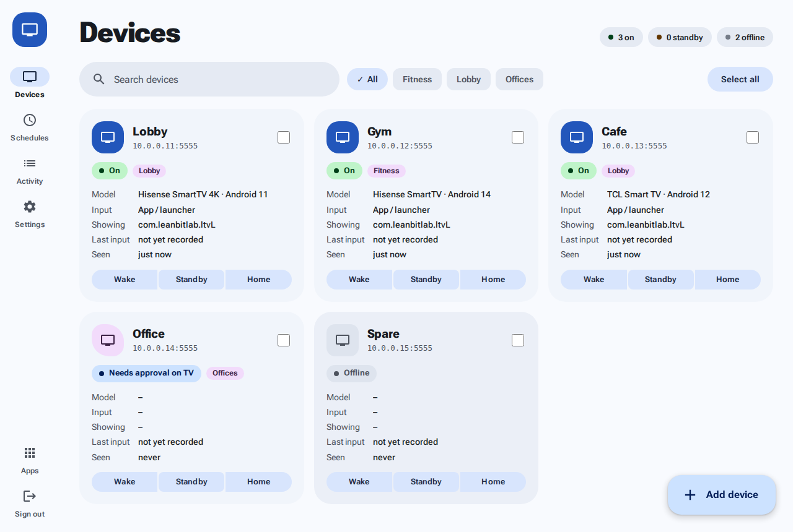
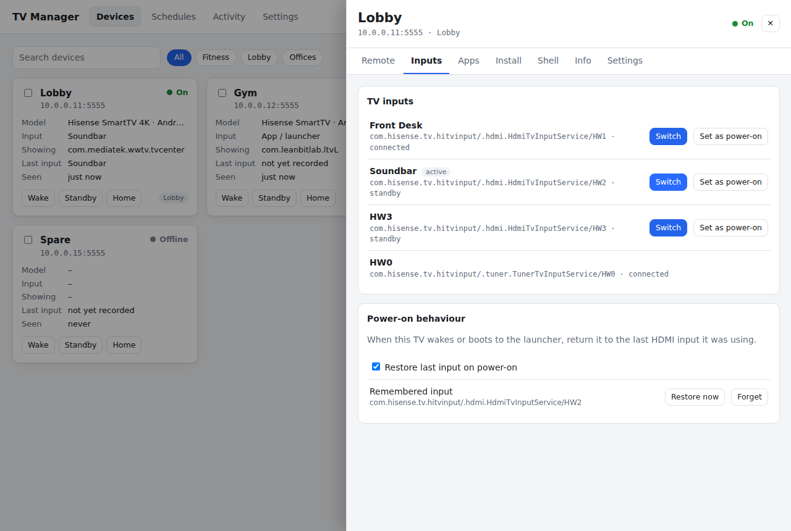
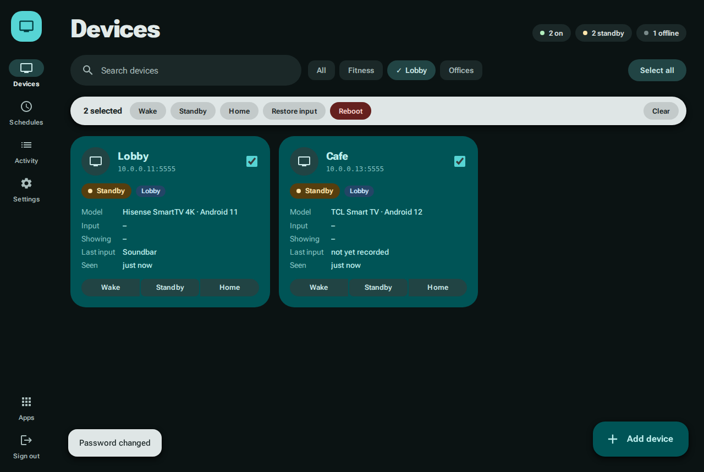
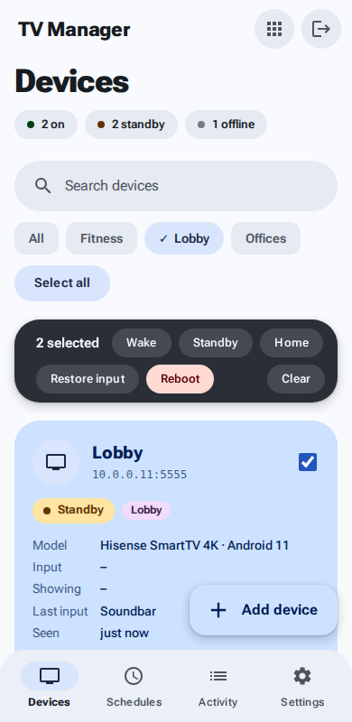

# TV ADB Manager

A self-hosted web dashboard for managing Android TVs over ADB, like lightweight device management
for sets that have no MDM. Built for locked-down or "debloated" TVs (Hisense, TCL, others) on a LAN.

* **Fleet view**: live status (on / standby / offline / needs approval), model, Android version,
  current input, foreground app. Groups, search, multi-select and bulk actions.
* **Remote**: D-pad, volume, media keys, wake/standby/reboot, keyboard control, screenshots.
* **Screen**: watch what a TV is showing, live, in the browser (needs `ffmpeg` on the server), with snapshot,
  fullscreen and a mini remote underneath.
* **Inputs**: list HDMI/tuner inputs (with the TV's own custom labels), switch with one click.
* **Power-on restore**: remembers each TV's last HDMI input and puts it back after standby wake,
  reboot or power loss. This replaces the "power on to last input" feature that lives in the stock
  launcher, which is lost when that launcher is disabled.
* **Apps**: list user / system / disabled packages; launch, stop, enable, disable, clear data,
  uninstall. Install APKs by upload.
* **Shell**: run `adb shell` commands from the browser, with history and quick commands.
* **Schedules**: wake, standby, reboot, go Home or switch input at set times.
* **Activity log**, **device info** (storage, memory, uptime, IP), password login.
* **Material 3 Expressive design**: tonal dynamic colour from a seed hue you pick, light/dark/auto, navigation rail
  that becomes a bottom bar on phones, side sheet that becomes a bottom sheet, springy shape-morphing motion.

Pure Python 3 standard library on the server, plain JS in the browser. No dependencies, no build step.



| Inputs and power-on restore | Dark theme, teal accent | Phone |
|---|---|---|
|  |  |  |

*Screenshots use the simulated fleet from `tools/fake_adb.py`.*

## Documentation

* [Setup guide](docs/setup.md): preparing TVs, installing, systemd, HTTPS
* [Using the dashboard](docs/features.md): every screen and the power-on restore logic
* [HTTP API](docs/api.md): script it with curl
* [Architecture](docs/architecture.md): how polling and restore work, and why it runs on a server
* [Security](docs/security.md) · [Troubleshooting](docs/troubleshooting.md) · [Development](docs/development.md)

## Quick start

Requirements: Python 3.9+, `adb` on the PATH, `ffmpeg` (optional, only for the live screen view), TVs with *Developer options → ADB debugging (network)* on.

```bash
git clone https://github.com/douggreenak/tv-adb-manager && cd tv-adb-manager
python3 -m tvmanager            # http://<server>:8420
```

On first run a random password is generated and printed (and stored hashed in `data/auth.json`).
Set your own with `TVM_PASSWORD=...` or in **Settings**. Add TVs by IP in the UI; the first time a TV
sees this server it shows an "Allow USB debugging?" prompt, so accept it there (tick *Always allow*).

### Run as a service

```bash
sudo cp deploy/tv-adb-manager.service /etc/systemd/system/    # edit User= and paths first
sudo systemctl enable --now tv-adb-manager
```

### Configuration

| Variable / flag | Default | |
|---|---|---|
| `TVM_HOST` / `--host` | `0.0.0.0` | bind address (use `127.0.0.1` behind a reverse proxy) |
| `TVM_PORT` / `--port` | `8420` | |
| `TVM_DATA` / `--data` | `./data` | devices, schedules, auth hash, activity log |
| `TVM_PASSWORD` | random on first run | overrides the stored password at start-up |
| `TVM_ADB` / `--adb` | `adb` | adb binary, or the fake in `tools/` for testing |
| `TVM_POLL` / `--poll` | `3` | seconds between device polls |

## Security

This tool gives a shell on every TV. It has a password login (scrypt), HttpOnly/SameSite cookies, a
CSRF header on all writes, login throttling and strict input validation for keys, packages and
addresses, but it serves **plain HTTP**. Keep it on a trusted LAN, or put it behind a TLS reverse
proxy / VPN. Never expose it to the internet.

## How power-on restore works

Each poll reads the TV's wakefulness, active TV-input session and foreground activity in one `adb`
call. While awake on a passthrough input (HDMI, composite…), that input is remembered. When a TV
wakes from standby, or reappears after being unreachable (power loss, reboot), the manager waits a few
seconds and, **only if the TV landed on its launcher** (not on an input and not in an app the user
opened), launches the remembered input with
`am start -a android.intent.action.VIEW -d content://android.media.tv/passthrough/<input id>`.
It can be turned off per TV, and a manual "Restore now" button is on the Inputs tab.

Limits: this runs on the server because Android TVs kill background apps in standby, so an on-device
app can't do it (see `experiments/`). It needs the TV to stay reachable on the network in standby
and a running server. A TV that fully drops off the network is restored when it comes back. Tuner
channels are not restored, only passthrough inputs.

## Testing without TVs

`tools/fake_adb.py` is a drop-in `adb` that simulates a fleet (Hisense A11/A14, TCL, an unapproved TV
and an unreachable one) with realistic `dumpsys` output and stateful power, input and package
behaviour. It never touches the network.

```bash
python3 -m unittest discover -s . -p "test_*.py" -t .   # unit, API and fake-fleet end-to-end tests
python3 tests/e2e_ui.py                                  # browser test (pip install playwright)

export FAKE_ADB_STATE=/tmp/fleet.json
python3 tools/fake_adb.py ctl seed
TVM_ADB=$PWD/tools/fake_adb.py TVM_DATA=/tmp/tvm-demo TVM_PORT=8431 python3 -m tvmanager
python3 tools/fake_adb.py ctl power 10.0.0.11:5555 off   # pull the plug on a fake TV
python3 tools/fake_adb.py ctl approve 10.0.0.14:5555     # accept the prompt on the unapproved one
```

## Layout

```
tvmanager/   adb wrapper, parsers, monitor (polling + restore), scheduler, auth, HTTP server
web/         the single-page UI
tests/       unit, API and fake-fleet tests, plus the browser test
tools/       fake_adb.py, the simulated TV fleet
deploy/      systemd unit
experiments/ an on-device Android app that was tried first and abandoned (see its README)
```

## License

MIT. Third-party: the UI bundles [Roboto Flex](https://github.com/googlefonts/roboto-flex) (SIL OFL 1.1, licence in
`web/fonts/OFL.txt`) and inlines Material Icons path data (Apache-2.0).
